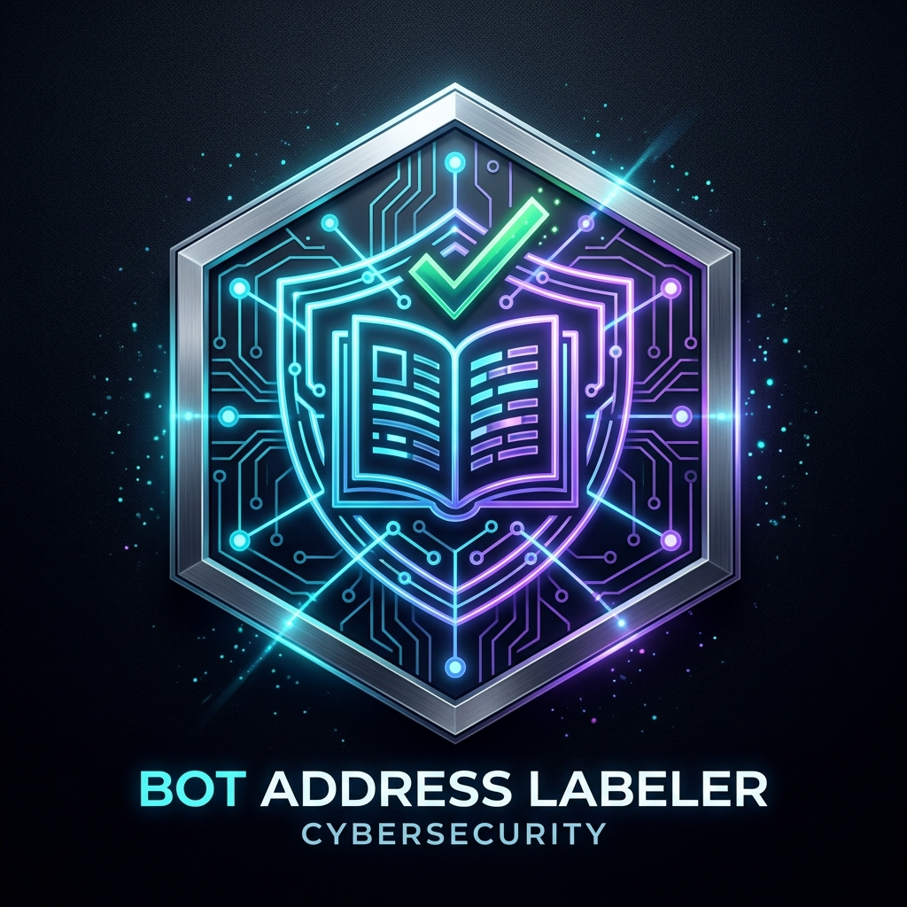

# BOT Address Labeler

<p align="center">
  
</p>

<p align="center">
  <strong>A Decentralized Address Book & Verified Project Registry Protocol on BOT Chain</strong>
</p>

<p align="center">
  <a href="https://scan.bohr.life/address/0xA17E767F0E6b4A2B0A58046CaFede7ed92be82AF#code"></a>
  
  
  
</p>

---

## 🌟 Overview

**BOT Address Labeler** solves the *hexadecimal usability paradox* on EVM blockchains. Instead of forcing users and protocols to interact with opaque 42-character hexadecimal strings (`0x8920...43e7`), the protocol introduces a decentralized, dual-tier on-chain registry for human-readable labels and cryptographically verified project profiles.

### Core Features
- **📖 Private / Personal Address Books:** Users maintain their own isolated on-chain labels (`Personal`, `Treasury`, `Team`, `Marketing`, `Exchange`, `Operations`).
- **🏢 Official Project Profiles:** Protocols publicly register decentralized profiles and catalog official multi-sig treasuries, developer funds, and operational safes.
- **🛡️ Proofs vs. Claims Architecture:** Clear distinction between unverified claims and cryptographically authenticated wallet ownership (via EIP-191 ECDSA challenge signatures).
- **⚡ Global Search Indexer:** Real-time multi-attribute search across addresses, projects, and categories with instant reverse lookups.
- **📜 Verified On-Chain:** Fully deployed and verified on BOT Chain Mainnet.

---

## 🔗 Live Deployment (BOT Chain)

| Parameter | Mainnet Details |
| :--- | :--- |
| **Network Name** | **BOT Chain** |
| **Chain ID** | `968` (`0x3c8`) |
| **Currency** | `BOT` |
| **RPC Endpoint** | `https://rpc.bohr.life` |
| **Block Explorer** | [scan.bohr.life](https://scan.bohr.life) |
| **Contract Address** | [`0xA17E767F0E6b4A2B0A58046CaFede7ed92be82AF`](https://scan.bohr.life/address/0xA17E767F0E6b4A2B0A58046CaFede7ed92be82AF#code) |
| **Status** | **✓ Pass - Verified (Green Checkmark on BOTScan)** |

---

## 🏗️ Project Structure

```
├── contracts/
│   ├── BOTAddressRegistry.sol     # Core smart contract
│   └── build/                     # Compiled ABI & bytecode
├── docs/
│   └── WHITEPAPER.md              # Full academic & technical whitepaper
├── public/
│   └── logo.png                   # Brand identity icon
├── scripts/
│   └── deploy.js                  # Deployment script for BOT Chain
├── src/
│   ├── contractData.js            # Contract ABI, addresses & network parameters
│   ├── state.js                   # Reactive state manager & live RPC sync
│   ├── main.js                    # Web application logic & UI routing
│   ├── style.css                  # Cyber-futuristic CSS design system
│   └── icons.js                   # SVG icon system
├── test/
│   └── BOTAddressRegistry.t.sol   # Foundry test suite (7/7 tests passed)
├── foundry.toml                   # Foundry configuration
└── package.json
```

---

## 🚀 Quick Start

### 1. Clone & Install Dependencies
```bash
git clone https://github.com/webtrovert0x/Labeler.git
cd Labeler
npm install
```

### 2. Configure Environment
Create a `.env.local` file:
```bash
cp .env.example .env.local
```
Add your private key with BOT gas tokens:
```env
PRIVATE_KEY=your_private_key_here
VITE_PRIVATE_KEY=your_private_key_here
```

### 3. Run the Frontend Locally
```bash
npm run dev
```
Open [http://localhost:5173/](http://localhost:5173/) in your browser.

---

## 🧪 Testing & Smart Contract Verification

### Run Foundry Tests
```bash
forge test -vvv
```

### Verify Contract on BOTScan via CLI
```bash
forge verify-contract \
  0xA17E767F0E6b4A2B0A58046CaFede7ed92be82AF \
  contracts/BOTAddressRegistry.sol:BOTAddressRegistry \
  --verifier-url https://scan.bohr.life/api \
  --verifier blockscout \
  --compiler-version 0.8.20 \
  --num-of-optimizations 200 \
  --via-ir \
  --watch
```

---

## 📄 Documentation

Read the full protocol specification, security model, and roadmap in [docs/WHITEPAPER.md](docs/WHITEPAPER.md).

---

## ⚖️ License
MIT License.
